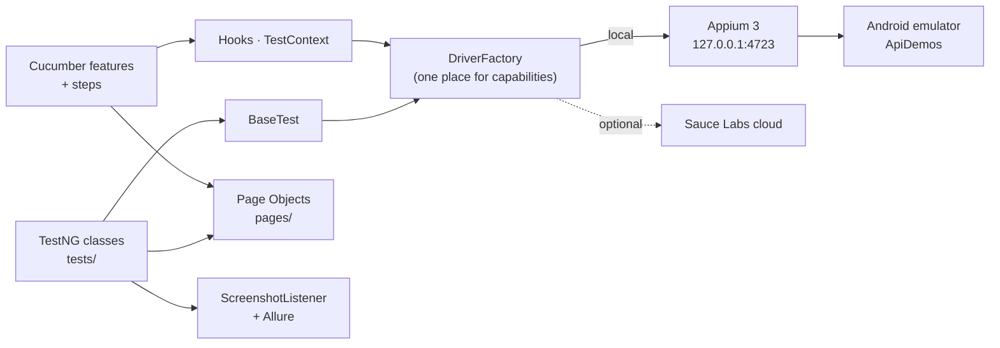
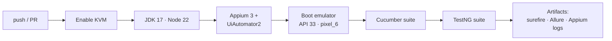

<div align="center">

# 📱 Appium Android Automation — ApiDemos

### Mobile test framework: Appium 3 + TestNG + Cucumber, running on a real Android emulator in CI

[](https://git.io/typing-svg)

<!-- ============ STATUS BAR ============ -->
[](https://github.com/rbchy/AppiumTest_Andriod_Automation/actions/workflows/tests.yml)


</div>

---

## 📌 At a Glance

<table>
<tr>
<td width="50%" valign="top">

**🙋 What this is**

A Java mobile test framework for Google's **[ApiDemos](https://github.com/appium/android-apidemos)** Android app, built with **Appium (UiAutomator2)**, **TestNG**, **Cucumber** and the **Page Object Model**. It covers far more than taps: install / upgrade / uninstall, background and kill-relaunch, rotation, incoming calls and SMS, network loss, low battery, accessibility labels, performance thresholds and a REST Assured API layer.

Every push boots an **Android API 33 emulator in GitHub Actions**, starts Appium 3 and runs both suites — the same way they run on a desk.

> *Quality is never an accident; it is always the result of intelligent effort.*

</td>
<td width="50%" valign="top">

**📍 Quick facts**

| | |
|---|---|
| 📦 **App** | ApiDemos-debug.apk (in `apks/`) |
| 🤖 **Device** | Android emulator, API 33, `emulator-5554` |
| 🧪 **TestNG** | 58 tests · 55 ✅ · 0 ❌ · 3 ⏭️ |
| 🥒 **Cucumber** | 4 scenarios · 4 ✅ |
| ⏱️ **CI time** | ≈ 9 min TestNG · 1.5 min Cucumber |
| 📊 **Reports** | Allure · screenshots on failure |

</td>
</tr>
</table>

---

## ✅ Latest Results (GitHub Actions, Android emulator API 33)

| Suite | Command | Total | ✅ Passed | ❌ Failed | ⏭️ Skipped |
|---|---|---:|---:|---:|---:|
| **TestNG** — `FullRegressionSuite` | `mvn test` | 58 | 55 | 0 | 3 |
| **Cucumber** — `CucumberSuite` | `mvn test -DsuiteXmlFile=testng-cucumber.xml` | 4 | 4 | 0 | 0 |

The 3 skips are deliberate `SkipException`s, not failures: ApiDemos does not expose the same *Text → EditText* sub-screen on every API level, so those tests skip instead of reporting a false failure. The same numbers come out of a local emulator run.

---

## 🎯 Test Coverage

| Category | Where | What it checks |
|---|---|---|
| 💨 Smoke | `EnterpriseTestSuite` | App launch, basic navigation |
| 🔄 Regression | `CombinedApiDemosTests` | Menu counts, text validation, back navigation, soft assertions |
| ♻️ App lifecycle | `EnterpriseTestSuite`, `CombinedApiDemosTests` | Kill / relaunch, background / foreground, rotation, app reset |
| 📦 Install / upgrade / uninstall | `InstallLifecycleTests` | Fresh install → reinstall → uninstall → reinstall |
| 📞 Interrupts | `InterruptSimulationTests` | Incoming call, SMS, network loss, low battery (emulator commands) |
| 🧭 Navigation & journeys | `E2EJourneyTests` | Multi-step exploration, rotation variant, stress journey |
| 📱 Device behaviour | `EnterpriseTestSuite` | Screen size, platform version, orientation |
| 🔐 Permissions & security | `PermissionPage`, `EnterpriseTestSuite` | Grant / deny handling, state cleared after termination |
| 🚫 Negative | `EnterpriseTestSuite` | Invalid element interaction, empty input |
| ⚡ Performance | `EnterpriseTestSuite` | Launch time, scroll response, wait thresholds |
| ♿ Accessibility | `EnterpriseTestSuite` | Content descriptions, tap-target sizes |
| 📊 Data-driven | `CombinedApiDemosTests` | `@DataProvider` multi-screen navigation |
| 🔌 API | `ApiIntegratedTests` | REST Assured: status codes, fields, 404 negative |
| 🥒 BDD | `api_demos_navigation.feature` | Main screen shows 12 items; Accessibility / Animation / Graphics open and return |

---

## 🏗️ How It Fits Together



**Engineering practices**

- **One driver factory** — `config/DriverFactory` builds the session for both TestNG and Cucumber (local emulator or Sauce Labs)
- **Page Object Model** shared by both test styles
- **Test isolation** — `ensureOnMainScreen()` stops one failure cascading into the next
- **State-based assertions** — navigation verified by screen-state change, not hard-coded text
- **Self-healing lookups** with scroll-based fallback for labels that differ between APK builds
- **Retry and explicit waits** in `WaitUtils` instead of `Thread.sleep`
- **Fast reset via ADB** (`pm clear`) instead of a slow full reinstall; `driver.findElements()` instead of `currentActivity()`, which can hang on a busy emulator
- **Graceful skips** for environment-dependent screens
- **Allure for both suites**, with a screenshot attached automatically on failure

---

## 🔄 CI/CD — GitHub Actions



[`.github/workflows/tests.yml`](.github/workflows/tests.yml) uses [android-emulator-runner](https://github.com/ReactiveCircus/android-emulator-runner); [`.github/scripts/run-appium-tests.sh`](.github/scripts/run-appium-tests.sh) turns off device animations, starts Appium, waits for `/status`, runs one suite and keeps its reports.

---

## 🚀 Getting Started (local)

1. **Java 17** and **Maven 3**
2. **Appium 3** with the UiAutomator2 driver (Node 20.19+):
   ```bash
   npm install -g appium@3
   appium driver install uiautomator2
   ```
3. **Android SDK** with `adb`, and an emulator running as `emulator-5554` (Android Studio → Device Manager)
4. The APK is already in `apks/ApiDemos-debug.apk` ([source](https://github.com/appium/android-apidemos/releases))

```bash
appium                                              # terminal 1
adb devices                                         # emulator-5554 should be listed

mvn clean test                                      # TestNG FullRegressionSuite (default)
mvn clean test -DsuiteXmlFile=testng-cucumber.xml   # Cucumber BDD suite
allure serve target/allure-results                  # view the report
```

From the IDE, right-click **`testng.xml`** (not a single class) → **Run As › TestNG Suite**, so the suite parameters reach `BaseTest`.

<details>
<summary><strong>☁️ Sauce Labs (optional)</strong></summary>

<br>

`testng-saucelabs.xml` and `testng-saucelabs-crossdevice.xml` run the same tests on Sauce Labs. They ship with **empty** credential values — never commit real ones. Supply them as environment variables instead:

```bash
export SAUCE_USERNAME=your-username
export SAUCE_ACCESS_KEY=your-key
mvn clean test -DsuiteXmlFile=testng-saucelabs.xml
```

</details>

---

## 📁 Project Structure

```
AppiumTest_Andriod_Automation/
├── .github/
│   ├── workflows/tests.yml          ← emulator + Appium + both suites on every push
│   └── scripts/run-appium-tests.sh
├── apks/ApiDemos-debug.apk
├── pom.xml                          ← default suite testng.xml
├── testng.xml                       ← FullRegressionSuite (6 test classes)
├── testng-cucumber.xml              ← Cucumber runner
├── testng-saucelabs*.xml            ← optional cloud runs (no credentials inside)
└── src/test/
    ├── java/
    │   ├── config/DriverFactory.java     ← local or Sauce Labs AndroidDriver
    │   ├── base/BaseTest.java            ← TestNG session lifecycle
    │   ├── hooks/                        ← Cucumber Hooks + TestContext (ThreadLocal)
    │   ├── runners/CucumberTestRunner.java
    │   ├── stepdefinitions/ApiDemosSteps.java
    │   ├── pages/                        ← MainScreen, Accessibility, Animation, Text, Permission
    │   ├── listeners/ScreenshotListener.java
    │   ├── utils/WaitUtils.java
    │   └── tests/                        ← InstallLifecycle, CombinedApiDemos, EnterpriseTestSuite,
    │                                        InterruptSimulation, ApiIntegrated, E2EJourney
    └── resources/
        ├── allure.properties
        └── features/api_demos_navigation.feature
```

---

## 🧹 Maintenance Log

| Change | Why |
|---|---|
| GitHub Actions on a real Android emulator | Every push now proves the suites still pass |
| `testng.xml` is the default suite | Plain `mvn test` failed without `-DsuiteXmlFile` |
| Removed `testng-mydemo-all.xml`, `testng-mydemo-local.xml`, `testng-saucelabs-mydemo.xml` | They only referenced `MyDemo*Tests` classes that do not exist, so they could never run |
| Windows paths (`C:\Users\…`) → repository-relative paths | They could not exist on macOS, Linux or CI |
| README badges and versions aligned with `pom.xml` | Header badges said java-client 9.2.2 / Selenium 4.19 / ExtentReports |

**Still open:** `base/MyDemoBaseTest.java` and `pages/mydemo/*` (with the `*-dump.xml` page dumps) are scaffolding for a **MyDemoApp** suite whose test classes were never committed. The `TestNG Report.pdf`, `TestNG reports.pdf` and `ExtentReport.html.pdf` files come from that suite's local runs, not from the ApiDemos suites above.

---

## 📈 Roadmap

- [x] CI on an Android emulator for both suites
- [ ] Commit the MyDemoApp test classes (or retire the scaffolding)
- [ ] Parallel runs on two emulator API levels
- [ ] Deep links, app notifications and slow-network retry scenarios
- [ ] Allure report published to GitHub Pages

---

## 🔗 Related Projects

| Project | Stack |
|---|---|
| ⭐ [RbcTcsWorld E-Commerce Suite](https://github.com/rbchy/RbcTcsWorld_ECommerceSuite) | Spring Boot · REST Assured · Selenium · Playwright · Appium 3 on Android and iOS |
| 🛍️ [Sauce Demo Shop Automation](https://github.com/rbchy/Sauce-Demo.MyShopify.AutomationTest) | Java · Selenium · Cucumber — CI green |
| 🔌 [API — Rest Assured](https://github.com/rbchy/QaBrainsAPIAutomationRestAssured) | Java · Rest Assured · Cucumber · Selenium — CI green |
| 🏥 [OpenEMR Healthcare](https://github.com/rbchy/OpenEMR_Automation) | Java · Selenium · Cucumber · TestNG — CI green |

<sub>All projects: [github.com/rbchy](https://github.com/rbchy)</sub>

---

## 👤 Author

<div align="center">

**Ranajit Baran Chowdhury (RB Chowdhury)**
QA Automation Engineer / SDET · West Norriton, Pennsylvania, USA

[](https://www.linkedin.com/in/rbchy/)
[](https://github.com/rbchy)
[](https://rbchy.github.io/rbchy/)
[](https://rbc6543.wixsite.com/rbc-portfolio)
[](mailto:chyranajit@gmail.com)

<sub>A learning and portfolio reference implementation — fork and adapt it to your own app.</sub>

⭐ *If this framework helps you, a star on the repo is appreciated.*

</div>
